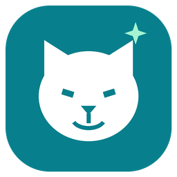

# NOTTY Smart Pet for Home Assistant



An **experimental, unofficial** Home Assistant integration for NOTTY automatic litter boxes and their associated pets, using the NOTTY cloud API. Install it through HACS as a custom repository.

This project originated from investigation of the NOTTY Android app. Authentication payloads, endpoint fallbacks, command codes, and field meanings include inferred behavior. Automated tests exercise mocked responses; **production login, controls, and device compatibility still require verification**. This is a cloud integration, not local control, and is not affiliated with NOTTY.

## Requirements

- Home Assistant **2026.3 or later** (bundled integration icons require 2026.3).
- A NOTTY account and a litter box already bound to that account.
- Internet access to `api.nottycat.com` and access to your NOTTY account email inbox.
- HACS for the HACS installation path.

## Install with HACS

1. Open **HACS → menu → Custom repositories**.
2. Add `https://github.com/Repsay/notty` with type **Integration**.
3. Find **NOTTY Smart Pet**, download it, and restart Home Assistant.
4. Open **Settings → Devices & services → Add integration → NOTTY Smart Pet**.
5. Enter your NOTTY email and region (`NL` by default). Request an email verification code, then enter the code in the next step.

For manual installation, copy `custom_components/notty` into your Home Assistant configuration's `custom_components/` directory, restart, and follow steps 4–5. Existing prototype users should replace their whole `custom_components/notty` folder after backing it up. The domain and entity unique-ID format are preserved.

This repository is intended for HACS custom-repository installation; it has not been accepted into the default HACS catalog.

## Entities and controls

Only fields returned by the account/device are exposed. The coordinator polls every 60 seconds.

| Platform | Features |
| --- | --- |
| Sensors | Litter box state, cleaning counts, pet weight/usage, event times, duration statistics, reminders and related data |
| Binary sensors | Connectivity, locks and reported boolean settings |
| Buttons | Clean, level, empty, sterilize, reminder resets, weight reset and calibration |
| Switches | Child lock, Do Not Disturb, litter-renewal reminder and trash-bag reminder |
| Selects | Cleaning mode, automatic cleaning delay, known screen languages and reminder intervals |
| Time | Do Not Disturb start/end |
| Update | Read-only firmware versions, availability and release-note summary |
| Number | Pet weight, with existing litter-box binding preserved |

Pet records become separate devices linked to the litter box. They do not receive litter-box command buttons. Known sensor fields use explicit units and device classes; unknown scalar fields remain ordinary sensors. Times and schedules are not guessed to be durations, and the weight-unit enum is not a weight measurement.

Automatic cleaning delay is available as a configuration select (1–15 minutes) when the device reports `auto_delay`. It is unavailable outside Auto mode, matching the app. Unknown delay values remain in the raw attributes without guessing a supported option.

DND changes preserve the reported LED setting and both time boundaries. The cloud has been observed returning DND wall times shifted by the Shanghai–Amsterdam UTC offset: echoing those values on write shifts the configured schedule again. This integration converts DND reads from the observed Asia/Shanghai clock basis to the Home Assistant timezone for display; writes send times in the configured NOTTY device `time_zone_iana` (falling back to Home Assistant's timezone only when NOTTY does not report a zone). Time edits are converted from HA time to the device zone. Invalid reported timezones and missing/invalid settings are rejected. The live behavior across DST transitions and other NOTTY regions still needs verification; see [APK contracts](docs/apk-contracts.md). Enabling DND with identical start and end times is rejected.

For physical litter boxes that report `open_litter_remind` or `open_garbagebag_remind`, configuration switches enable (`action=1`) or disable (`action=2`) each reminder using the reported configured interval (`default_remaining_days`: 5–30 days; `garbage_bag_cycle_time`: 2–15 days). **Both operations require `cycle_time`.** Owner tests on a real NOTTY device confirmed that action 1 enables the reminder and restarts its countdown, while action 2 disables it without changing the configured cycle. Unknown state or missing/invalid cycle data prevents writes. **The litter-renewal interval selector is enabled for an already enabled reminder:** an owner test confirmed that `action=3` changes the configured litter interval and updates the remaining countdown (30 → 29 days). Selecting the same interval skips the write. Reminder reset buttons and the trash-bag interval selector remain blocked, as their live semantics have not been established.

Two actions are also available in **Developer tools → Actions**: `notty.litter_box_one_key` and `notty.litter_box_action`. Their schemas are in [services.yaml](custom_components/notty/services.yaml). They require the **physical `user_device_id`**, not a pet ID. Command mappings remain experimental; verify them with your own device before relying on automations.

Reminder enable/disable is available through the configuration switches (both send the configured cycle, not the remaining-day countdown). `set_litter_reminder_days` supports a changed 5–30 day cycle when the device explicitly reports an enabled litter reminder. Generic reset and trash-bag interval actions still reject requests until verified against the live API.

## Sessions and troubleshooting

- Authentication uses email verification codes. Unverified password/Firebase exchanges have been removed; a rejected request is never automatically replayed with stored credentials.
- Email codes are discarded after the exchange. When a session expires, Home Assistant asks you to request a fresh code. Refresh-token renewal is **not implemented**; storing a server-provided refresh token does not imply it is used. Existing entries migrate without losing valid access tokens, while legacy passwords, Firebase overrides and stored codes are removed.
- Authentication failures request reauthentication; connection failures make entities unavailable and Home Assistant retries setup/updates.
- Device IDs and account-bound pet IDs differ. Use the probe's `--device-id` if automatic discovery does not identify your physical box.
- Download integration diagnostics from the integration menu for a report of datapoint paths and types. Credentials and response values are omitted.
- Endpoint fallbacks can omit unsupported related data. Missing fields are not proof that the device lacks a feature. New fields may require reloading the integration to create entities.

The original implementation assumes unqualified event timestamps are in `Asia/Shanghai`; UTC message fields are handled separately and converted to the device or Home Assistant time zone. Validate that assumption with live captures from your region.

## Probe datapoints

The developer tools run **without Home Assistant**. They retrieve known discovery/read endpoints and never call cleaning, settings, reset, firmware, or pet-write methods. Some read endpoints use POST query payloads, matching the prototype. Authentication can issue login requests.

```sh
uv sync --frozen --no-dev
export NOTTY_ACCESS_TOKEN='your-current-NOTTY-token'
export NOTTY_USER_ID='your-NOTTY-user-id'
uv run scripts/probe_datapoints.py --output probe-output/before.json
```

Alternatively set `NOTTY_EMAIL` and a fresh `NOTTY_VERIFICATION_CODE`. Password login is unsupported; `NOTTY_PASSWORD` is not read by the probe. Set `NOTTY_REGION_CODE` if needed. Credentials are read from the environment, not command arguments. Never paste them into issues.

Email verification codes are single-use. Add `--session-file probe-output/session.private.json` on the first run to save the established access token locally and reuse that file on later runs. The session file has owner-only permissions and is ignored by Git. It contains a token, user ID, email and region, never the verification code or password. An expired saved session needs a fresh login and a new session file. Saved sessions take precedence over email-code login; an explicit `NOTTY_ACCESS_TOKEN` takes precedence over the saved token.

```sh
# Optional: save sensitive API responses locally for investigation.
uv run scripts/probe_datapoints.py --device-id 123 \
  --output probe-output/after.json \
  --capture-raw probe-output/after.private.json

# Build a report from an existing capture, without network access.
uv run scripts/probe_datapoints.py --from-file probe-output/after.private.json

# Report fields added, removed, or changed in type; exit 1 when different.
uv run scripts/compare_datapoints.py probe-output/before.json probe-output/after.json
```

Reports contain JSON paths and observed types, not values. Review reports before sharing: backend-generated object keys can themselves contain identifiers. Raw captures contain personal/device data, are created with owner-only permissions, and must end in `.private.json`. Both that suffix and `probe-output/` are ignored by Git. Output files must be new, so captures are not accidentally overwritten. A top-level read failure yields exit 1 with partial results; authentication or local input/output failure yields exit 2. Optional endpoints omitted by the API client's fallbacks are not individually reported as errors.

## Development

```sh
uv sync --frozen --group dev
uv run ruff check .
uv run ruff format --check .
uv run mypy .
uv run pytest --cov=custom_components.notty --cov=scripts --cov-report=term-missing
uv run scripts/build_brand.py
```

Tests use Home Assistant's custom-component test plugin, synthetic fixtures, and mocked HTTP/API responses. GitHub Actions runs tests, Ruff, strict mypy, hassfest, and the HACS validator. Ruff checks the integration, developer scripts and tests; mypy checks the integration and developer scripts. The existing mypy test exclusion is retained. See [typing and lint policy](docs/development-checks.md) for the few framework-specific exceptions. The committed `uv.lock` pins the development environment. The icon is original community artwork; [assets/icon.svg](assets/icon.svg) and [scripts/build_brand.py](scripts/build_brand.py) provide editable sources.

See [development history](docs/development-history.md) and the [live validation checklist](docs/live-validation.md). Contributions should include a minimal synthetic fixture for any new field or endpoint mapping.

## License

MIT. NOTTY names and trademarks belong to their respective owners.

## Firmware availability

A **Firmware** update entity appears for each physical litter box that reports
`src_version` and `dest_version` through NOTTY's upgrade-check endpoint. It shows
the installed version, the offered version, a release-note summary (up to 255
characters) and the cloud's raw `task_status`. An explicitly empty target means
no offered update. Missing or malformed metadata makes the entity unavailable;
it does not mean the device is up to date. If the optional endpoint recovers
after startup, the entity appears without reloading the integration.

This is the read-only phase of [#22](https://github.com/Repsay/notty/issues/22).
The entity offers no install action, automatic updates or progress percentage.
Use the official NOTTY app to perform firmware updates. Raw task status is not
proof of measured progress or a successful installation; only fresh version
readback establishes the installed version. No physical device/model has been
validated for this new entity yet. See [APK firmware evidence](docs/apk-firmware.md).
